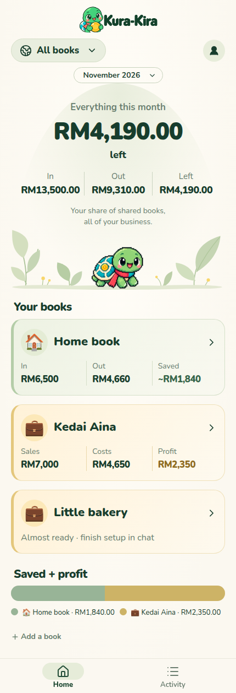
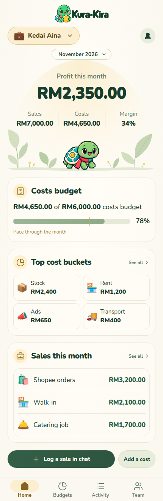
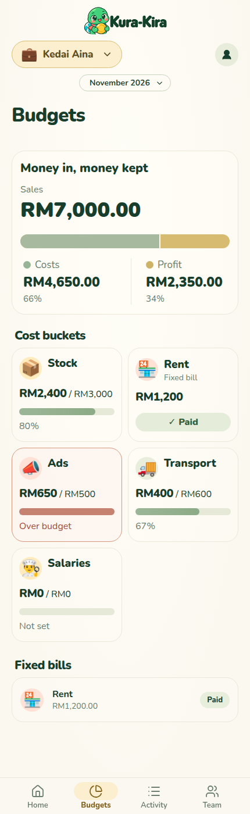
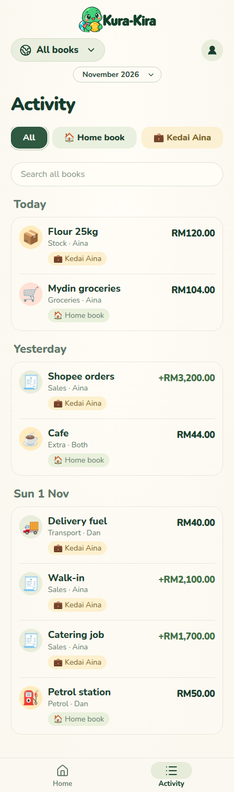
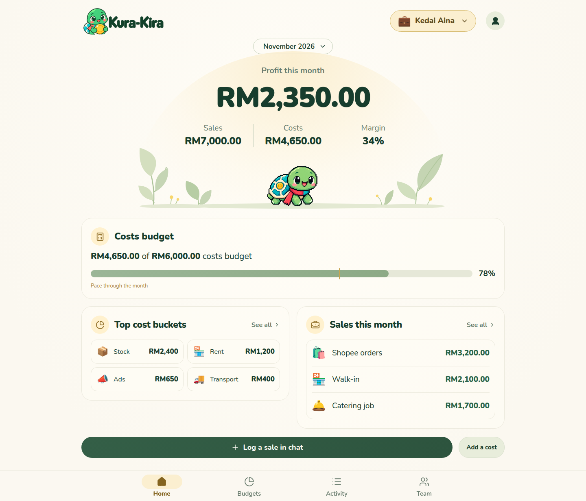
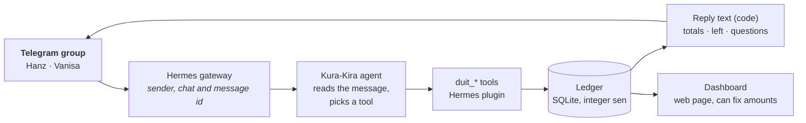
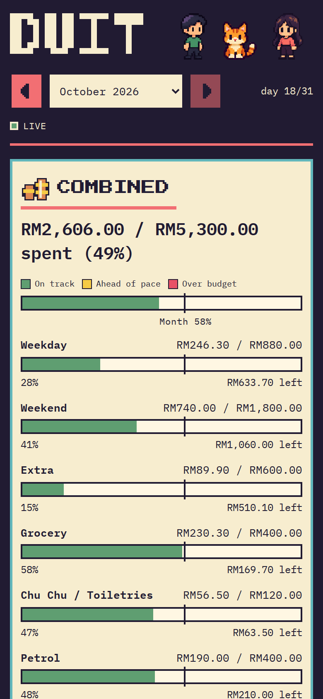

<p align="center">
  
</p>

<p align="center">
  <b>A spending tracker for two, run from your Telegram group.</b><br>
  Post what you spent in plain words. Kura-Kira files it against your monthly plan,<br>
  keeps track of who owes whom, and shows it all on a pixel-art dashboard.
</p>

<p align="center">
  
  <a href="https://github.com/NousResearch/hermes-agent"></a>
  
  
</p>

<p align="center">
  <a href="#how-it-works">How it works</a> ·
  <a href="#setup">Set up</a> ·
  <a href="#configuration">Configure</a> ·
  <a href="#usage">Use</a> ·
  <a href="#dashboard">Dashboard</a> ·
  <a href="#faq">FAQ</a>
</p>

<table align="center">
  <tr>
    <td align="center" valign="top"><br><sub><b>All your books</b></sub></td>
    <td align="center" valign="top"><br><sub><b>A business book</b></sub></td>
    <td align="center" valign="top"><br><sub><b>Budgets and bills</b></sub></td>
    <td align="center" valign="top"><br><sub><b>Activity</b></sub></td>
  </tr>
</table>

<p align="center"><sub>The dashboard Mini App from Kura-Kira Server, the hosted version of this bot. Sample data, made-up names.</sub></p>

> [!NOTE]
> This is a personal project, built around one couple's plan (Hanz and Vanisa, plus Chu Chu the cat). The people,
> budgets and buckets all live in `config.toml`, so you can change them, but the dashboard is designed for two.

Kura-Kira is a [Hermes Agent](https://github.com/NousResearch/hermes-agent) bot that sits in a Telegram
group. Whenever one of you spends money, you post it the way you'd tell each other: `Sushi-Mentai 56.50`,
`zapfan lunch 13.20 hanz 14.50 vanisa, hanz paid`, `petrol 50`. Kura-Kira records it in the right budget,
replies with how much is left, and asks when something is unclear. It never guesses who paid or which
bucket a spend belongs to.

The rule that holds it together: **the model only reads the message; code does the money.** A SQLite ledger
stores every spend and computes every total, weekly allowance, pace and balance. The model never adds up a
single ringgit.

## Features

| You post | Kura-Kira does |
|---|---|
| 🍣 **A spend:** `Sushi-Mentai (food) : 56.50` | Files it in the right bucket (Weekday or Weekend by the date) and replies with what's left this week. |
| 🍱 **A split:** `zapfan, lunch, RM13.20 hanz, 14.50 vanisa, Hanz paid` | Records each person's share and who paid, and updates the balance between you. |
| ❓ **Something unclear:** `watsons 75` | Saves it as **Unsorted** and asks: *Chu Chu / Toiletries or Extra?* It learns the answer for that place next time. |
| 💸 **No payer for a shared spend:** `nando's 69.70 split` | Asks who paid: *Hanz / Vanisa / Each paid own*. |
| 🤝 **A settle-up:** `vanisa paid hanz 86.30` | Clears the balance. Settle-ups never count against a budget. |
| 🏠 **A fixed bill:** `house paid` | Marks House or Car as paid for the month. |
| 📊 **A question:** `how are we doing?` / `how much do I have?` | Replies with the month so far, for both of you or just the sender. |
| ✏️ **A fix:** `undo`, `wrong, should be 85`, `delete #142` | Edits or soft-deletes the entry. |

What a reply looks like:

```
✅ #3 Sushi-Mentai · Weekend · RM56.50 · Hanz
   This weekend: target RM200.00 · spent RM82.20 · RM117.80 left 🟩
```

From the second week of a month, savings and overspending carry over:

```
   This week (weekdays): target RM100.00 + RM20.00 saved = RM120.00 · spent RM66.00 · RM54.00 left 🟩
   This weekend: target RM200.00 − RM30.00 overspent = RM170.00 · spent RM0.00 · RM170.00 left 🟩
```

Chat that isn't about money ("where to eat?", "reach in 10 min") gets no reply at all.

<p align="center">
  
</p>

<p align="center"><sub>The same Kura-Kira Server dashboard on a wider screen. Sample data, made-up names.</sub></p>

## How it works



- **The model reads; code counts.** The agent turns a message into a tool call: place, amount, how it was
  split (`even`, `2:1`, `for vanisa`), bucket, who paid. Code computes the shares, and the ledger
  (`duit/ledger.py`, `duit/report.py`) stores them and does all the arithmetic.
- **Every amount is checked against the message.** The gateway captures the original text before the model
  sees it, and an amount that doesn't appear in it is refused. Headcounts, ratios, times and `#ids` don't count
  as money.
- **The bot's reply is the ledger's text.** The model's own wording is replaced by reply lines built by code
  (`duit/replies.py`) from the ledger's numbers, so the chat can't show a total the ledger doesn't have.
- **The sender comes from Telegram, not the model.** Tools run as a Hermes plugin, which reads the sender's
  Telegram ID and the message ID from the gateway session. The model can't log a spend as the wrong person.
- **Nothing is guessed.** A missing bucket is stored as Unsorted, and a missing payer as unknown. The bot asks,
  and the entry stays in "Needs answer" until someone replies.
- **Safe to repeat.** The same Telegram message is recorded once, even if the gateway retries. Deletes are
  soft: the entry stays in the ledger, marked deleted. Every tool call is kept in an `audit` table.
- **Checked nightly.** `python -m duit check` verifies that shares add up, balances net to zero and every
  weekday/weekend entry matches its date. A nightly timer runs it after an online backup.

Every guard and the test that pins it are listed in [docs/ACCURACY.md](docs/ACCURACY.md).
- **Money is integer sen.** RM13.20 is stored as `1320`, and splits always add up to the exact total.

### The plan

Per person, per month (your real plan lives in `config.toml`):

| Bucket | Amount | Kind |
|---|---|---|
| Weekday (Mon–Fri) | RM20 a day (RM100 a full week) | weekly target with carry-over |
| Weekend (Sat–Sun) | RM70 a day (RM140 a full weekend) | weekly target with carry-over |
| Extra | RM300 | monthly cap |
| Grocery | RM200 | monthly cap, shared: split half each whoever paid |
| Chu Chu / Toiletries | RM60 | monthly cap, shared; never counts as weekday/weekend |
| Petrol | RM200 | monthly cap, shared |
| Toll | RM50 | monthly cap, shared |
| Parents | RM500 | fixed bill: Paid / Due |
| House | RM1,000 | fixed bill: Paid / Due (Vanisa auto-Paid) |
| Car | RM300 | fixed bill: Paid / Due (Vanisa auto-Paid) |
| Mopping machine | RM250 | installment, Sep–Nov 2026 only (Vanisa auto-Paid) |

The monthly total on the dashboard is the whole plan: spending targets plus every fixed bill.


- **Weekly buckets:** the budget is set per day, and a week's target is the daily amount times its days in
  the month (a full week is RM100 weekdays and RM200 weekend; Thursday–Friday is RM40; a lone Saturday is
  RM100). What you saved or overspent earlier in the month carries into this week: **can spend = target +
  carry-over**, never below RM0. The carry-over resets on the 1st.
- **Pace:** each bar is **on track** (green), **ahead of pace** (yellow, spending faster than the month or week
  is passing) or **over budget** (red).
- **Balance:** whoever paid is owed the other person's share. Settle-ups clear it.

The full rules are in [docs/PLAN.md](docs/PLAN.md); the agent's own instructions are in
[hermes/SOUL.md](hermes/SOUL.md).

## Setup

Kura-Kira runs on a machine that's always on (a home server, mini PC or small VPS) next to Hermes Agent.

### Prerequisites

| What | Why | How you get it |
|---|---|---|
| **Linux or macOS** | The ledger is Python; the dashboard runs as a systemd user service. | Windows works through WSL2. |
| **Python ≥ 3.11** | The ledger and dashboard use only the standard library. | Your system Python, or `uv`. |
| **[Hermes Agent](https://github.com/NousResearch/hermes-agent)** | Runs the bot, calls the model and connects to Telegram. | Its [official installer](https://hermes-agent.nousresearch.com). |
| **A model login** | The agent reads your messages. | The `kura-kira` profile uses the `openai-codex` provider: `hermes -p kura-kira auth add openai-codex`. |
| **A Telegram bot in your group** | Where you post spends. | [@BotFather](https://t.me/BotFather) → `/newbot`, connect it with `hermes setup gateway`, then add it to your group. |
| **Your Telegram user IDs** | Maps each sender to a person, so names can change. | Message [@userinfobot](https://t.me/userinfobot) from each account. |

### Install

```bash
git clone https://github.com/hanzong111/Kura-Kira.git && cd Kura-Kira
cp config.example.toml config.toml        # fill in your names and Telegram user IDs
./scripts/test.sh -q                      # creates .venv on first run, then runs the tests
```

Then set up the Hermes profile `kura-kira` (in `~/.hermes/profiles/kura-kira/`):

```bash
hermes profile create kura-kira
ln -s "$PWD/hermes/plugin/duit" ~/.hermes/profiles/kura-kira/plugins/duit
ln -s "$PWD/hermes/SOUL.md"     ~/.hermes/profiles/kura-kira/SOUL.md
```

and in the profile's config:

- `plugins.enabled: [duit]` to load the ledger tools
- `platform_toolsets: {telegram: [duit], cli: [duit]}`, so the bot has the ledger tools and nothing else
- the model: an OpenAI Codex model through the `openai-codex` provider
- `tools.tool_search.enabled: "off"`, so the duit tools are in the prompt up front instead of being looked
  up on every message
- `auxiliary.title_generation.enabled: false`: the plugin starts every message in a fresh session (the bot
  needs no chat history), so a session title would cost an extra model call per message

Install and start the gateway (`hermes -p kura-kira gateway install`, then `hermes -p kura-kira gateway start`),
post `test 1` in the group, then `undo` it.

### Nightly backup and check

```bash
deploy/install-nightly.sh                # systemd user timer, 03:30 every night
```

It backs up the ledger to `data/backups/` (keeping 30) and runs `python -m duit check`, logging to
`data/nightly.log`.

### The dashboard as a service

```bash
dashboard/install-service.sh             # http://localhost:8790, starts at login, restarts on failure
```

This links `dashboard/kura-kira-dashboard.service` into `~/.config/systemd/user/`, points it at
`~/duit/data/duit.db` and `~/duit/config.toml`, and starts it. Override with `DUIT_DB=… DUIT_CONFIG=…` in
front of the command.

To open it from your phone, put it behind something that adds a login, such as
[Tailscale](https://tailscale.com) (`tailscale serve 8790`) or an [ngrok](https://ngrok.com) tunnel with OAuth.
The dashboard itself has no login. It only answers requests for `localhost`, so list the tunnel's host name:

```bash
KURA_KIRA_HOSTS=your-name.ngrok-free.dev dashboard/install-service.sh
```

## Configuration

### `config.toml`: people, budgets and rules

Copied from `config.example.toml` and **gitignored**. The bot loads it when the gateway starts, so restart
the gateway after editing it (`hermes -p kura-kira gateway restart`). The dashboard reads it on every request.

```toml
timezone = "Asia/Kuala_Lumpur"
currency = "RM"

[people.hanz]
name = "Hanz"
telegram_id = 123456789          # the sender is matched by ID, never by display name

[buckets.weekday]
label = "Weekday"
kind = "weekly"                  # weekly: amount per day; a week's target = amount x its days
amount = 20                      # RM100 for a full Mon-Fri
days = [0, 1, 2, 3, 4]           # 0 = Monday … 6 = Sunday

[buckets.house]
label = "House"
kind = "fixed"                   # fixed: shown as Paid / Due, never a progress bar
amount = 1000
auto_paid = ["vanisa"]           # marked Paid automatically each month

[rules]
alert_at = [0.8, 1.0]            # warn at 80% and when a cap is passed
ask_extra_over = 100             # an everyday spend share above this asks "Everyday or Extra?"
# tracking_start = "2026-10-17"  # optional, if you start mid-month without backfilling (see below)
# before_start = "maxed"          # days before it: "maxed" = on budget, "ignore" = prorate
categories = ["Food", "Groceries", "Leisure", "Sport", "Transport", …]
```

Bucket kinds are `weekly`, `monthly` (a plain cap) and `fixed`.

**Starting mid-month:** run `python -m duit backfill 2026-10-01 2026-10-16` to add "Before tracking"
placeholder spends worth exactly the daily budget for those days, so the empty first half of the month
doesn't turn into savings. It's safe to re-run, and the placeholders stay out of Top places. Alternatively, set
`tracking_start` with `before_start = "maxed"`. You can also change a budget from the chat:
`plan: grocery 250`, `vanisa petrol 150`. That changes the month's plan, and later months copy it forward.

### Environment variables

| Variable | Default | What |
|---|---|---|
| `DUIT_DB` | `data/duit.db` | The ledger file (gitignored) |
| `DUIT_CONFIG` | `config.toml`, else `config.example.toml` | The plan |
| `KURA_KIRA_PORT` | `8790` | Dashboard port |
| `KURA_KIRA_HOSTS` | *(empty)* | Extra host names the dashboard answers to, comma-separated (for a tunnel) |

## Usage

### From the group chat


- `Sushi-Mentai 56.50` · `grab 18.40` · `petrol 50` · `jaya grocer 72.80`
- `lunch 12, petrol 50`: several spends in one message
- `zapfan lunch 13.20 hanz 14.50 vanisa, hanz paid` · `dinner 80 split` · `60 split 2:1 hanz paid`
- `gsc movie 2 pax 44`: "2 pax" is a headcount, not a split, so it's all the sender's
- `yesterday kopi 8.90`: the date comes from when the message was sent
- `vanisa paid 70 dinner` sent by Hanz: a plain spend belongs to whoever paid it, so this is Vanisa's
- `grab 25 for vanisa`: all Vanisa's, paid by the sender
- Answering a question: reply to the bot's message with `hanz paid`, `each paid own`, `extra` or `sport lah`
- `undo` · `delete #142` · `wrong, should be 85` · `edit #142 food 30`
- `house paid` · `house + car paid`
- `vanisa paid hanz 86.30` · `settled`
- `how are we doing?` · `how much do I have?`
- `plan: grocery 250` · `weekend 250`

### From the command line

```bash
.venv/bin/python -m duit status            # this month in the terminal
.venv/bin/python -m duit status 2026-09    # another month
.venv/bin/python -m duit json              # the full status as JSON
.venv/bin/python -m duit check             # integrity checks (exit 1 on a problem)
.venv/bin/python -m duit backup            # online backup to data/backups/ (keeps 30)
.venv/bin/python -m duit backfill 2026-10-01 2026-10-16   # on-budget placeholders before tracking began

.venv/bin/python eval/run.py               # the parsing test set against the live agent
.venv/bin/python eval/run.py -k split      # only cases matching "split"
```

`eval/cases.toml` holds real-world messages, each with the ledger state it should produce. Each case
runs in a fresh ledger through the real agent.

### The agent's tools

| Tool | For |
|---|---|
| `duit_log_spend` | Record a spend (place, amount or shares, payer, bucket, category, date) |
| `duit_answer` | Apply an answer to the bot's question (who paid / which bucket) |
| `duit_edit_spend` · `duit_delete_spend` | Fix or remove an entry (`undo` = the sender's latest) |
| `duit_settle_up` | Money paid back between you |
| `duit_pay_fixed` · `duit_fixed_due` | House and car: mark paid, list what's due |
| `duit_set_plan` | Change a budget |
| `duit_status` · `duit_list_spends` · `duit_pending` | Read the month, the spends, the open questions |
| `duit_lookup_place` | What bucket and category a place was learned as |

## Dashboard



A page on `http://localhost:8790` that updates live as the bot writes to the ledger. It has two
layouts drawn from the same data: a desktop layout from 768px wide and a phone layout below that.

- **Desktop:** the answers come first: money left this month (with a marker for where the month should
  be), what each person can spend this week, and who owes whom. Below them is one budgets table, with
  installments as rows whose bar shows the whole plan (paid so far against the total, months paid), and
  fixed bills as a row of badges with their paid state. A side column shows who paid and the top places,
  then the spending log with search, filter chips, category and payer selects and an Export CSV button.
  A Both/person switch in the header filters everything, including the log.
- **Phone:** an overview with a household or per-person switch, a bucket detail with that week's target
  and spends, a searchable spends list with a detail sheet, and a who-paid tab that leads with settling
  up. Inside Telegram the detail views use the Telegram back button.
- **Fixing things:** an Edit button on a spend fixes its amount (a split said in the message is edited
  share by share; otherwise the total is re-split by the usual rule). "Change amounts" on the budgets
  table, or clicking a fixed bill, sets this month's amount per person (per day for weekday/weekend).
  Past months stay as they were; later months copy the new amount when they start.

Try it with a demo month:

```bash
python3 -m dashboard.seed_demo                     # builds data/demo.db
DUIT_DB=data/demo.db python3 -m dashboard.server   # http://localhost:8790
```

The server uses only the Python standard library. It opens a fresh connection per request (so the bot
can keep writing) and reports changes over server-sent events (`/api/events`). Read endpoints:
`/api/status?month=YYYY-MM`, `/api/spends?month=&person=&bucket=&category=&paid_by=&q=`, and
`/api/spends.csv` with the same filters. Write endpoints: `POST /api/spend` (fix a spend's amount) and
`POST /api/plan` (set a budget or bill for this month). They call the same ledger methods as the bot, so
shares, totals and the balance follow on their own, and they only accept a JSON body whose `Origin`
matches the `Host`, so another site can't post through a tab that's logged in behind the tunnel.

The look is the **DUIT Co-op Arcade** pack: sprites, skyline, pixel icons and self-hosted fonts in
`dashboard/web/duit/`. Its design handoff, reference mockup and source art are in
[docs/design/duit-arcade/](docs/design/duit-arcade/FRONTEND_HANDOFF.md).

<br clear="right">

## Project layout

```
duit/                  the ledger (stdlib only)
  config.py              plan: people, buckets, rules (config.toml)
  money.py               amounts as integer sen; parsing, splitting
  periods.py             months, Mon-Sun weeks, weekly targets and carry-over
  db.py                  SQLite schema
  ledger.py              every write: log_spend, resolve, edit, undo, settle, pay_fixed, set_plan
  report.py              every read: bucket status, pace, balance, paid totals, pending questions
  replies.py             chat text built from the ledger's numbers
  tools.py               the agent's tools: JSON schemas, amount checks, split maths, audit
  textcheck.py           which numbers in a message can be money
  integrity.py           `duit check` and `duit backup`
  backfill.py            on-budget placeholders for days before tracking began
hermes/
  plugin/duit/           Hermes plugin: the tools (toolset `duit`) and gateway hooks
  SOUL.md                the agent's rules
dashboard/
  server.py              web server, edit endpoints + SSE
  seed_demo.py           a demo month in data/demo.db
  web/                   index.html, app.js, app.css; duit/ = the arcade asset pack
  kura-kira-dashboard.service, install-service.sh
deploy/                nightly backup + check (systemd user timer)
eval/                  parsing test set run against the real agent
tests/                 pytest suite (no network, no model)
docs/                  PLAN.md, ACCURACY.md, the dashboard brief, design pack, README images
config.example.toml    the plan to copy into config.toml
```

## Status

| Step | Part | State |
|---|---|---|
| 1 | Ledger + tests | done |
| 2 | Agent tools as a Hermes plugin | done |
| 3 | Parsing test set + agent rules + merchant catalogue | 44/44 on the live model |
| 4 | Hermes `kura-kira` profile + Telegram group | live |
| 5 | Scheduled messages (written by code): House/Car due 1st+5th, Sunday recap, month report; 80%/over alerts in every reply; nightly check + backup | done |
| 6 | Trial week | under way |
| 7 | Dashboard (DUIT Co-op Arcade design) | done |

## FAQ


**Why a Hermes plugin and not an MCP server?** Hermes doesn't show the model the sender's Telegram ID or the
message ID, but plugin tools can read both from the gateway session. So the model never chooses who spent the
money, and a retried message is recognised as a duplicate.

**Why does it keep asking who paid?** When a spend involves both of you, or someone else is named, and the
message doesn't say who paid, guessing would put the balance wrong. A plain message from one person is
assumed to be paid by that person.

**What if it files something wrong?** Reply `wrong, should be 85`, `edit #142 grocery`, or `undo`. When you
answer a bucket question, it remembers the answer for that place.

**What's "carry-over"?** Each week starts from its target (RM100 weekdays, RM200 weekends). If you spent
RM80 of last week's RM100, this week you can spend RM120. If you overspent, this week shrinks, but never
below RM0. It resets on the 1st, so the month never goes over plan.

**Can more than two people use it?** The ledger takes any number of people from `config.toml`. The bot's
rules and the dashboard (P1 / P2 cards, "who owes whom") are written for two.

**Where's my data?** In `data/duit.db` on your machine. Messages you post in the group go to Telegram and,
for reading, to the model provider behind Hermes. The dashboard doesn't send anything anywhere.

## Privacy

- **Local ledger.** Every spend, plan and balance is in one SQLite file on your machine (`data/duit.db`,
  gitignored), along with `config.toml` and its Telegram IDs. The ledger's `audit` table keeps each tool call
  with the message that caused it, and `data/backups/` keeps 30 nightly copies.
- **What leaves the machine.** Group messages are read by Telegram and by the model provider that Hermes uses.
  Code computes the numbers in the bot's replies; the model only chooses which tool to call.
- **The dashboard has no login and can change amounts.** It listens on `127.0.0.1` only, refuses other host
  names, and only accepts writes whose `Origin` matches the `Host`. Anyone who can open it can fix spends and
  budgets, so put a login in front of it (Tailscale, or an ngrok tunnel with OAuth) before opening it to your phone.

## Credits

Built on [Hermes Agent](https://github.com/NousResearch/hermes-agent) by Nous Research.

The dashboard art (Hanz, Vanisa, Chu Chu, the skyline) was generated for this project; its prompts and source
images are in [docs/design/duit-arcade/source/](docs/design/duit-arcade/source/), and its provenance in
[ASSET_PROVENANCE.md](dashboard/web/duit/licenses/ASSET_PROVENANCE.md). Fonts: [Press Start 2P](https://github.com/google/fonts/tree/main/ofl/pressstart2p)
for headings, [VT323](https://github.com/google/fonts/tree/main/ofl/vt323) for text and numbers, and
[IBM Plex Mono](https://github.com/IBM/plex) as the fallback, all under the SIL Open Font License (notices in
`dashboard/web/duit/licenses/` and `dashboard/web/fonts/`).

No license has been chosen for the code yet.
